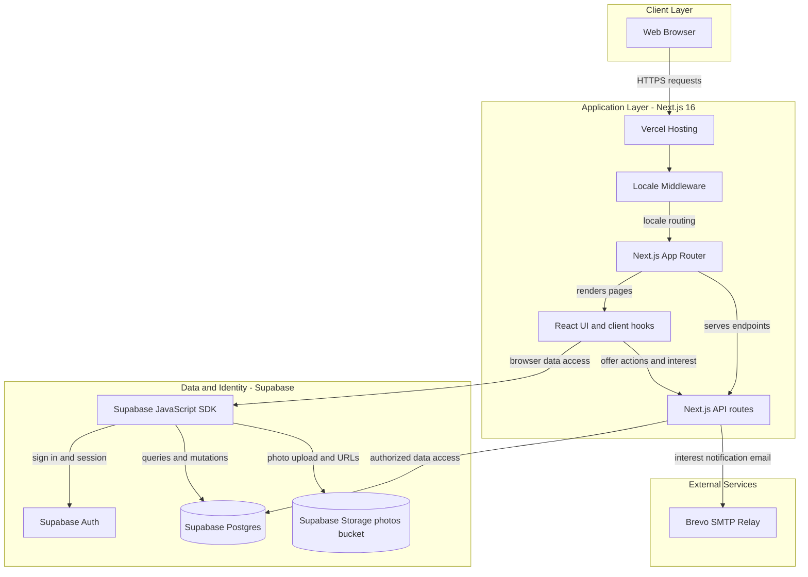
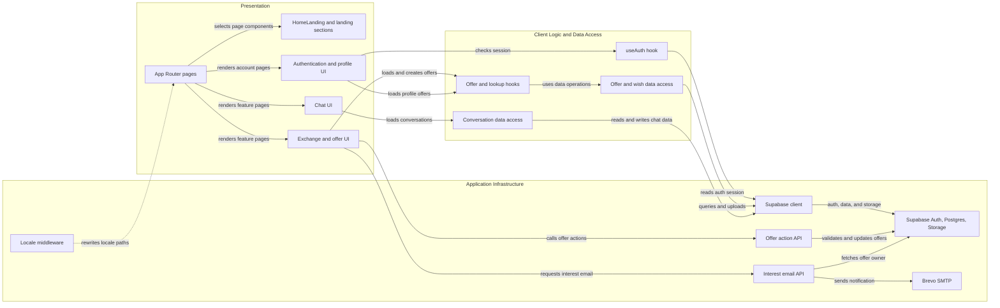

# Architecture Diagram

troCASH is a Next.js web application prepared for Vercel hosting and Supabase-backed authentication and data. The diagrams show the integrations present in the code; the checked-in SQL currently defines only part of the schema used by the application.

## Application Architecture

<!-- mermaid-checked: no \n, no em-dash/en-dash, no {} in labels, subgraphs are id["label"], arrows are -->|"label"|, all subgraphs closed by end, ids unique -->

### Technology Stack Summary

| Layer | Technology | Version | Purpose |
|---|---|---|---|
| Web application | Next.js | 16.3.0 | App Router pages, locale middleware, and API routes |
| User interface | React | 19.2.8 | Interactive client and server-rendered UI |
| Application code | JavaScript and TypeScript | TypeScript 7.0.2 | Application modules and typed page/layout files |
| Data and identity | Supabase JavaScript SDK | ^2.112.2 | Auth, Postgres data access, and object storage |
| Email | Nodemailer | ^10.0.1 | Sends interest notifications through Brevo SMTP |
| Hosting | Vercel | Target in README | Intended deployment platform |

### Data Storage & External Services

Supabase provides authentication, Postgres data access, and a `photos` Storage bucket used for offer images. The checked-in `supabase/schema.sql` defines profiles, offers, wishes, exchange requests, and reports with row-level security policies. Application code also accesses `category`, `location`, `conversations`, and `messages`; their table definitions are not present in the checked-in SQL files. The interest API route sends email through Brevo's SMTP relay. No payment provider is wired into the current code.

### Key Architectural Decisions

- Client-side features use the Supabase JavaScript SDK directly; API routes handle selected server-side offer actions and email notifications.
- Locale selection is handled by Next.js middleware using hostname-to-path rewrites for Portuguese, English, and Ukrainian.
- Supabase row-level security is used for ownership and participant access to the core tables defined in the SQL schema.

## Component Relationships

<!-- mermaid-checked: no \n, no em-dash/en-dash, no {} in labels, subgraphs are id["label"], arrows are -->|"label"|, all subgraphs closed by end, ids unique -->

### Component Inventory

| Component | Layer | Type | Responsibility |
|---|---|---|---|
| App Router pages | Presentation | Next.js routes | Composes landing, exchange, offers, chat, auth, and profile pages |
| HomeLanding and landing sections | Presentation | React component | Composes the landing-page header, hero, catalog, sections, and footer |
| Exchange and offer UI | Presentation | React pages and client components | Browses offers, submits offers, and triggers offer actions |
| Chat UI | Presentation | React client component | Loads and displays conversations and messages |
| Authentication and profile UI | Presentation | React pages and client components | Handles sign-in state and profile views |
| Locale middleware | Infrastructure | Next.js middleware | Rewrites hostnames to locale paths |
| useAuth hook | Client Logic | React hook | Tracks Supabase auth state and mirrors a limited session summary into a cookie |
| Offer and lookup hooks | Client Logic | React hooks | Coordinates offer workflows and category/location lookups |
| Offer and wish data access | Data Access | Data access modules | Reads and writes offers and wishes; uploads offer photos through the storage module |
| Conversation data access | Data Access | Data access module | Finds or creates conversations and retrieves messages |
| Supabase client | Infrastructure | JavaScript SDK client | Connects browser-facing code to Supabase Auth, Postgres, and Storage |
| Offer action API | Infrastructure | Next.js API route | Authenticates offer owners and performs supported offer status changes |
| Interest email API | Infrastructure | Next.js API route | Looks up offer owner details and sends an interest notification |
| Supabase Auth, Postgres, Storage | Infrastructure | Managed backend services | Provides identity, relational data, and offer-photo storage |
| Brevo SMTP | External Service | SMTP relay | Delivers interest notification emails |
